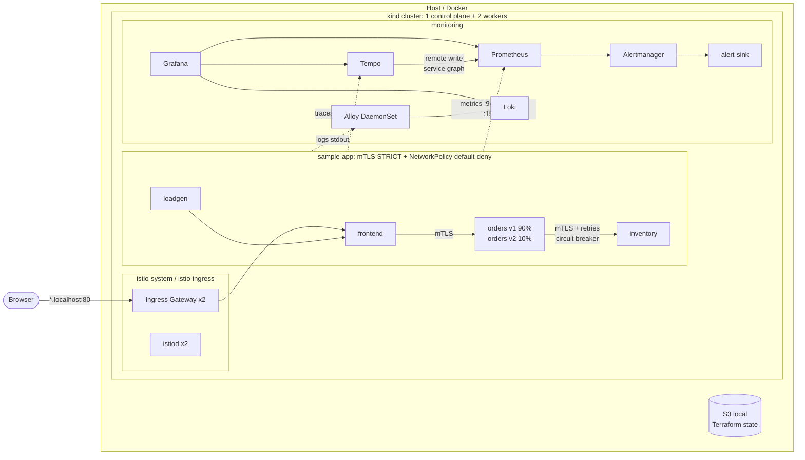
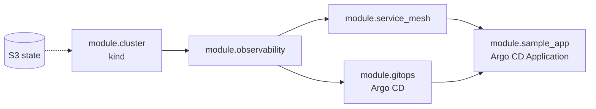
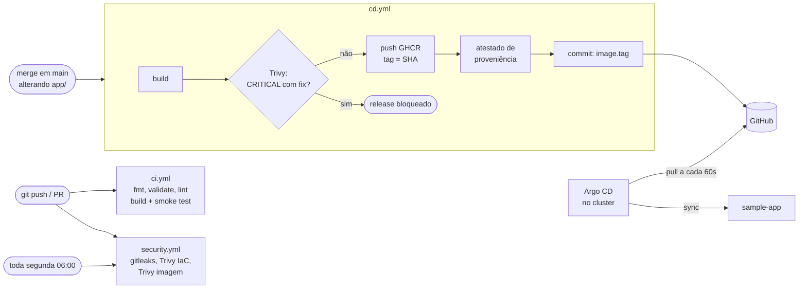

# Infra Tech Challenge III: Kubernetes & Observability

Cluster Kubernetes local (kind, 1 control plane + 2 workers) com stack completa de observabilidade (Prometheus, Loki, Tempo, Grafana), service mesh (Istio) e uma aplicação de 3 microsserviços instrumentada. A plataforma é provisionada por Terraform, com **um comando**; a aplicação é entregue por **GitOps (Argo CD)** a partir de uma esteira com gates de segurança.

```bash
make up
```

## Sumário

- [Arquitetura](#arquitetura)
- [Pré-requisitos](#pré-requisitos)
- [Como usar](#como-usar)
- [O que foi entregue](#o-que-foi-entregue)
- [Esteira CI/CD e GitOps](#esteira-cicd-e-gitops)
- [Tour pela observabilidade](#tour-pela-observabilidade)
- [Estrutura do repositório](#estrutura-do-repositório)
- [Decisões e trade-offs](docs/decisions.md)

## Arquitetura



**Fluxo dos três sinais:**

| Sinal    | Origem                                  | Coleta                        | Armazenamento | Correlação no Grafana                       |
|----------|-----------------------------------------|-------------------------------|---------------|---------------------------------------------|
| Métricas | app (`prometheus_client`), Envoy, cluster | PodMonitor / ServiceMonitor | Prometheus    | exemplars → trace                           |
| Logs     | stdout JSON com `trace_id`              | Grafana Alloy                 | Loki          | `trace_id` → trace                          |
| Traces   | OpenTelemetry SDK + sidecars Envoy      | OTLP/gRPC                     | Tempo         | trace → logs, trace → métricas, service map |

**Ordem de provisionamento** (dependências declaradas no Terraform):



Terraform é dono da **plataforma** (cluster, observabilidade, mesh, Argo CD) e dos **parâmetros de ambiente** da aplicação. O Argo CD é dono da **entrega** da aplicação.

## Pré-requisitos

| Ferramenta | Versão testada |
|------------|----------------|
| Docker     | 29.x           |
| kind       | 0.31           |
| Terraform  | ≥ 1.5          |
| kubectl    | 1.33           |
| helm       | 3.x / 4.x      |

Recursos: ~6 GB de RAM livres, 4 CPUs e a porta 80 livre no host.

**Linux:** o kind multi-nó precisa de limites maiores de `inotify` (o `make preflight` verifica):

```bash
sudo sysctl -w fs.inotify.max_user_watches=524288 fs.inotify.max_user_instances=512
```

## Como usar

```bash
make up        # state backend + cluster + observabilidade + mesh + app (~10 min)
make verify    # testes end-to-end de toda a plataforma
make info      # URLs prontas e credenciais (Grafana e Argo CD)
make down      # destrói o cluster (mantém o state)
make clean     # remove o backend de state
make help      # todos os comandos
```

Tudo é publicado por uma **entrada única**: o Istio Ingress Gateway na porta 80 do host, com roteamento por hostname.

| Serviço      | URL                          | Login             |
|--------------|------------------------------|-------------------|
| Aplicação    | http://app.localhost         |                   |
| Grafana      | http://grafana.localhost     | `admin` / `make info` |
| Argo CD      | http://argocd.localhost      | `admin` / `make info` |
| Prometheus   | http://prometheus.localhost  |                   |
| Alertmanager | http://alertmanager.localhost |                  |

O backend do Terraform state roda **fora do cluster**, de propósito (o state precisa sobreviver a ele), e tem a própria UI:

| Serviço | URL | Login |
|---|---|---|
| Terraform state (Versity S3 Gateway) | http://localhost:7071 | access key / secret em `make info` |

Nela dá para ver o bucket `tfstate` e o **histórico de versões do state**, uma por `apply`.

Qualquer `*.localhost` resolve para 127.0.0.1 sem consultar DNS (RFC 6761), tanto no browser quanto no sistema. Onde isso não funcionar, use `ingress_domain = "127.0.0.1.nip.io"` no `terraform.tfvars` (DNS público). Para usar outra porta, altere `ingress_host_port`.

`make up` executa:

1. `preflight`: checa ferramentas e limites do kernel.
2. `state`: sobe o S3 local (Docker Compose) e cria o bucket versionado.
3. `init`: `terraform init` com o backend S3 do ambiente.
4. `apply`: cria tudo.
5. `info`: mostra os acessos.

Os ambientes ficam em `terraform/environments/<env>/` (tfvars + backend). Para outro ambiente: `make up ENV=<env>`.

O Argo CD acompanha a **branch em que você está** (`GITOPS_REVISION`, padrão `git rev-parse --abbrev-ref HEAD`). A branch precisa existir no GitHub.

### Exemplo de saída do `make verify`

```
Cluster
  PASS 3 nodes Ready (1 control plane + 2 workers)
  PASS No pod in Pending/Failed state
  PASS PersistentVolumeClaims bound
Application
  PASS Ingress gateway -> frontend -> orders -> inventory
  PASS HPAs are reading CPU metrics
Ingress
  PASS Grafana published at http://grafana.localhost
  PASS Prometheus published at http://prometheus.localhost
  PASS Alertmanager published at http://alertmanager.localhost
  PASS Argo CD published at http://argocd.localhost
GitOps
  PASS Argo CD application Synced and Healthy
  PASS Workloads run the image published by the CD pipeline
Metrics
  PASS Application metrics scraped
  PASS Envoy (Istio) metrics scraped
  PASS Control plane metrics scraped (etcd, scheduler, controller-manager)
  PASS SLO recording rules evaluated
  PASS Tempo service graph metrics remote-written
Logs
  PASS Application logs in Loki
  PASS Control plane logs in Loki (kube-system)
  PASS Log agent runs without root and without capabilities
Traces
  PASS Traces for frontend in Tempo
  PASS TraceQL metrics (Grafana Traces Drilldown)
Alerting
  PASS Watchdog alert reaching Alertmanager
Security
  PASS Service-to-service traffic uses mutual TLS
  PASS NetworkPolicy blocks inventory -> frontend
  PASS Mesh-wide PeerAuthentication is STRICT
  PASS RBAC: developers can scale deployments
  PASS RBAC: developers cannot read secrets
```

## O que foi entregue

### Requisitos principais

| Requisito | Implementação |
|-----------|---------------|
| Cluster local via Terraform, 1 CP + 2 workers | `modules/kind-cluster`: subnets de pod/service explícitas, kube-proxy iptables, workers em 2 "zonas" |
| Rede entre nós | kindnet (CNI com suporte a NetworkPolicy) |
| Volumes persistentes | StorageClass `standard` (local-path); PVCs para Prometheus, Alertmanager, Grafana, Loki e Tempo |
| Prometheus | kube-prometheus-stack, incluindo métricas de etcd, scheduler, controller-manager e kube-proxy |
| Loki | modo single binary, schema v13/TSDB, retenção configurável |
| Tempo | OTLP gRPC/HTTP, metrics-generator (service graph + span metrics) |
| Grafana | datasources pré-configurados e correlacionados; 3 dashboards próprios + dashboards da comunidade |
| App de microsserviços | `frontend → orders → inventory` emitindo métricas, logs e traces |

### Componentes adicionais

| Área | Implementação |
|------|---------------|
| RBAC | Role `sample-app-developer` para o grupo `sample-app-developers` (pode escalar, não lê Secrets) |
| Network policies | default-deny + allow por chamador + allow de scrape vindo de `monitoring` |
| Secrets | senha do Grafana gerada pelo Terraform e entregue via Secret (`existingSecret`) |
| PDB | serviços da app, istiod e ingress gateway |
| Requests/limits | todos os workloads, inclusive charts de terceiros e sidecars |
| Probes | readiness/liveness em todos os serviços da app |
| HPA | todos os Deployments da app, por CPU do container `app` (`ContainerResource`) |
| AlertManager | roteamento, inibição e webhook (`alert-sink`, visível no Loki) |
| Dashboards | *Sample App - RED & SLO*, *Service Mesh - Istio*, *Cluster Health & Cost* |
| SLO/SLI | recording rules + alertas multi-window multi-burn-rate (99,5% disponibilidade, 99% < 500 ms) |
| Custo | custo mensal estimado por namespace, custo ocioso e eficiência requests × uso |
| Módulos Terraform | 4 módulos com interfaces explícitas |
| Remote state | backend S3 local versionado (Versity S3 Gateway) |
| Variáveis por ambiente | `environments/<env>/terraform.tfvars` + `backend.hcl` |
| Service mesh | Istio 1.30 (sidecar) |
| mTLS | `PeerAuthentication` STRICT mesh-wide |
| Tráfego | canary 90/10 (orders v1/v2), retries, timeouts, circuit breaker (connection pool + outlier detection) |
| Traces do mesh | Envoy → Tempo via Telemetry API (OpenTelemetry) |
| Dashboards do mesh | taxa de sucesso, latência, fluxo origem → destino, split do canary, response flags |
| GitOps | Argo CD (pull), `AppProject` restrito ao repositório e ao namespace, auto-sync com prune e self-heal |
| Esteira de segurança | gitleaks (histórico completo), Trivy IaC e imagem com SARIF na aba Security, scan semanal, gate de release |
| Supply chain | actions de terceiros fixadas por SHA, atestado de proveniência (SLSA) assinado da imagem |
| CI | `terraform fmt/validate`, `helm lint`, build + smoke test da imagem |

## Esteira CI/CD e GitOps



| Workflow | Quando roda | Bloqueia? | Por quê |
|----------|-------------|-----------|---------|
| `ci.yml` | push em `main` e PR | sim | O código está correto e a imagem sobe |
| `security.yml` · gitleaks | push em `main`, PR, semanal | **sim** | Credencial vazada é sempre acionável; o histórico inteiro é varrido porque apagar o segredo depois não o revoga |
| `security.yml` · Trivy IaC/imagem | push em `main`, PR, semanal | não (reporta) | Imagens base trazem CVEs sem correção publicada; os achados vão para a aba Security para triagem. O scan semanal pega CVEs novos em imagens que não mudaram |
| `cd.yml` | merge em `main` alterando `app/` | **sim** (CRITICAL com correção) | Nenhuma vulnerabilidade crítica corrigível chega ao registry |

Por que **pull** e não push: o GitHub Actions não alcança um cluster local ou privado. A esteira só publica artefatos e registra a nova versão no Git; o Argo CD, de dentro do cluster, puxa a mudança. Nenhuma credencial do cluster sai dele.

Na prática:
- **Self-heal**: uma alteração manual (por exemplo, apagar a NetworkPolicy default-deny) é desfeita pelo Argo CD em cerca de 10 s.
- **Rastreabilidade**: cada deploy é um commit `deploy(sample-app): <sha>`, e a imagem tem atestado verificável:
  ```bash
  gh attestation verify oci://ghcr.io/flowramps/infra-tech-challenge-iii/sample-app:<tag> -R flowramps/Infra-tech-challenge-III
  ```
- **Loop impossível**: commits feitos com `GITHUB_TOKEN` não disparam novos workflows.

## Tour pela observabilidade

Depois do `make up`, abra o Grafana. A pasta **Tech Challenge** tem quatro dashboards:

1. **Sample App - RED & SLO**
   - Taxa, erros e latência por serviço.
   - Clique em um ponto de *exemplar* no gráfico de latência para abrir o trace no Tempo.
   - Os painéis de SLO mostram o error budget e o burn rate.
   - No painel de logs, cada `trace_id` é um link para o trace.
2. **Service Mesh - Istio**
   - Service graph gerado a partir dos traces.
   - Percentual do tráfego protegido por mTLS.
   - Split do canary.
   - Painel "errors absorbed by retries": o inventory falha ~2%, mas o orders quase não vê erros graças aos retries.
3. **Cluster Health & Cost**
   - Saúde de nós e pods.
   - Custo mensal estimado por namespace e custo ocioso.
4. **GitOps - Argo CD**
   - Estado de sync/health das aplicações, operações de sync e latência do Git.

Para ver os alertas de SLO disparando:

```bash
make chaos       # inventory passa a falhar 50% (Terraform -> Application -> Argo CD, sem drift)
# Alertmanager em ~5 min; notificações no Loki: {namespace="monitoring", app="alert-sink"}
make chaos-off   # restaura o valor do tfvars
```

Para mudar o peso do canary, altere `canary_weight` em `terraform.tfvars` e rode `make apply`.

## Estrutura do repositório

```
.
├── .github/workflows/           # ci, security e cd
├── Makefile                     # ponto de entrada único
├── app/                         # microsserviço instrumentado (FastAPI + OpenTelemetry)
├── bootstrap/                   # S3 local para o Terraform state (Docker Compose)
├── docs/decisions.md            # decisões de design e trade-offs
├── scripts/verify.sh            # testes end-to-end
└── terraform/
    ├── main.tf                  # composição dos módulos
    ├── environments/local/      # terraform.tfvars + backend.hcl
    └── modules/
        ├── kind-cluster/        # cluster kind
        ├── observability/       # Prometheus, Alertmanager, Grafana, Loki, Tempo, Alloy
        │   ├── values/          # values dos charts (templates)
        │   └── dashboards/      # dashboards Grafana (JSON)
        ├── service-mesh/        # Istio + chart local com mTLS, tracing e monitors
        ├── gitops/              # Argo CD
        └── sample-app/          # namespace, RBAC, Application do Argo CD + chart da aplicação
```

## Limitações conhecidas

- Os backends de observabilidade rodam com 1 réplica e filesystem local. Em produção: modos distribuídos com object storage (S3/GCS).
- O state local não tem locking. Em equipe: S3 com `use_lockfile` ou DynamoDB.
- O state local usa access key fixa porque o backend local não tem IAM/STS. **Em produção: roles com o mínimo privilégio e credenciais temporárias** (SSO para pessoas, OIDC para o pipeline, IRSA/Pod Identity para workloads), nunca usuários técnicos com access keys. Ver [decisões, seção 2](docs/decisions.md#2-remote-state-em-s3-local-versity-s3-gateway).
- O custo é uma estimativa por requests com preço de referência, não a fatura de um provedor.
- O `make up` depende do GitHub e do GHCR (o Argo CD sincroniza do repositório público e os nós baixam a imagem publicada).

Detalhes e justificativas em [docs/decisions.md](docs/decisions.md).
