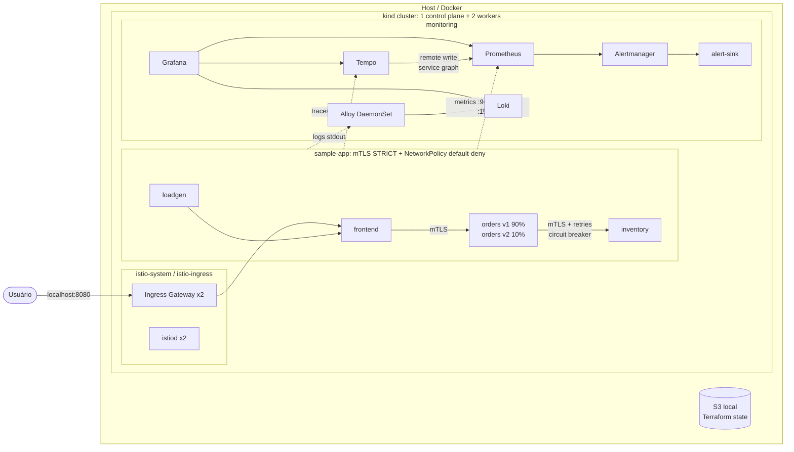
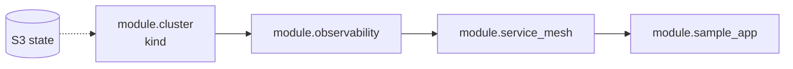

# Infra Tech Challenge III: Kubernetes & Observability

Cluster Kubernetes local (kind, 1 control plane + 2 workers) com stack completa de observabilidade (Prometheus, Loki, Tempo, Grafana), service mesh (Istio) e uma aplicação de 3 microsserviços instrumentada. Tudo é provisionado por Terraform, com **um comando**.

```bash
make up
```

## Sumário

- [Arquitetura](#arquitetura)
- [Pré-requisitos](#pré-requisitos)
- [Como usar](#como-usar)
- [O que foi entregue](#o-que-foi-entregue)
- [Tour pela observabilidade](#tour-pela-observabilidade)
- [Estrutura do repositório](#estrutura-do-repositório)
- [Decisões e trade-offs](docs/decisions.md)

## Arquitetura



**Fluxo dos três sinais:**

| Sinal    | Origem                                  | Coleta                        | Armazenamento | Correlação no Grafana                       |
|----------|-----------------------------------------|-------------------------------|---------------|---------------------------------------------|
| Métricas | app (`prometheus_client`), Envoy, cluster | PodMonitor / ServiceMonitor | Prometheus    | exemplars → trace                           |
| Logs     | stdout JSON com `trace_id`              | Grafana Alloy                 | Loki          | `trace_id` → trace                          |
| Traces   | OpenTelemetry SDK + sidecars Envoy      | OTLP/gRPC                     | Tempo         | trace → logs, trace → métricas, service map |

**Ordem de provisionamento** (dependências declaradas no Terraform):



## Pré-requisitos

| Ferramenta | Versão testada |
|------------|----------------|
| Docker     | 29.x           |
| kind       | 0.31           |
| Terraform  | ≥ 1.5          |
| kubectl    | 1.33           |
| helm       | 3.x / 4.x      |

Recursos: ~6 GB de RAM livres e 4 CPUs.

**Linux:** o kind multi-nó precisa de limites maiores de `inotify` (o `make preflight` verifica):

```bash
sudo sysctl -w fs.inotify.max_user_watches=524288 fs.inotify.max_user_instances=512
```

## Como usar

```bash
make up        # state backend + cluster + observabilidade + mesh + app (~10 min)
make verify    # testes end-to-end de toda a plataforma
make info      # URLs e senha do Grafana
make down      # destrói o cluster (mantém o state)
make clean     # remove o backend de state
make help      # todos os comandos
```

| Serviço      | URL                    |
|--------------|------------------------|
| Aplicação    | http://localhost:8080  |
| Grafana      | http://localhost:3000 (`admin` / `make info`) |
| Prometheus   | http://localhost:9090  |
| Alertmanager | http://localhost:9093  |

`make up` executa:

1. `preflight`: checa ferramentas e limites do kernel.
2. `state`: sobe o S3 local (Docker Compose) e cria o bucket versionado.
3. `init`: `terraform init` com o backend S3 do ambiente.
4. `apply`: cria tudo.
5. `info`: mostra os acessos.

Os ambientes ficam em `terraform/environments/<env>/` (tfvars + backend). Para outro ambiente: `make up ENV=<env>`.

### Exemplo de saída do `make verify`

```
Cluster
  PASS 3 nodes Ready (1 control plane + 2 workers)
  PASS No pod in Pending/Failed state
  PASS PersistentVolumeClaims bound
Application
  PASS Ingress gateway -> frontend -> orders -> inventory
  PASS HPAs are reading CPU metrics
Metrics
  PASS Application metrics scraped
  PASS Envoy (Istio) metrics scraped
  PASS Control plane metrics scraped (etcd, scheduler, controller-manager)
  PASS SLO recording rules evaluated
  PASS Tempo service graph metrics remote-written
Logs
  PASS Application logs in Loki
Traces
  PASS Traces for frontend in Tempo
Alerting
  PASS Watchdog alert reaching Alertmanager
Security
  PASS Service-to-service traffic uses mutual TLS
  PASS NetworkPolicy blocks inventory -> frontend
  PASS Mesh-wide PeerAuthentication is STRICT
  PASS RBAC: developers can scale deployments
  PASS RBAC: developers cannot read secrets
```

## O que foi entregue

### Requisitos principais

| Requisito | Implementação |
|-----------|---------------|
| Cluster local via Terraform, 1 CP + 2 workers | `modules/kind-cluster`: subnets de pod/service explícitas, kube-proxy iptables, workers em 2 "zonas" |
| Rede entre nós | kindnet (CNI com suporte a NetworkPolicy) |
| Volumes persistentes | StorageClass `standard` (local-path); PVCs para Prometheus, Alertmanager, Grafana, Loki e Tempo |
| Prometheus | kube-prometheus-stack, incluindo métricas de etcd, scheduler, controller-manager e kube-proxy |
| Loki | modo single binary, schema v13/TSDB, retenção configurável |
| Tempo | OTLP gRPC/HTTP, metrics-generator (service graph + span metrics) |
| Grafana | datasources pré-configurados e correlacionados; 3 dashboards próprios + dashboards da comunidade |
| App de microsserviços | `frontend → orders → inventory` emitindo métricas, logs e traces |

### Componentes adicionais

| Área | Implementação |
|------|---------------|
| RBAC | Role `sample-app-developer` para o grupo `sample-app-developers` (pode escalar, não lê Secrets) |
| Network policies | default-deny + allow por chamador + allow de scrape vindo de `monitoring` |
| Secrets | senha do Grafana gerada pelo Terraform e entregue via Secret (`existingSecret`) |
| PDB | serviços da app, istiod e ingress gateway |
| Requests/limits | todos os workloads, inclusive charts de terceiros e sidecars |
| Probes | readiness/liveness em todos os serviços da app |
| HPA | todos os Deployments da app, por CPU do container `app` (`ContainerResource`) |
| AlertManager | roteamento, inibição e webhook (`alert-sink`, visível no Loki) |
| Dashboards | *Sample App - RED & SLO*, *Service Mesh - Istio*, *Cluster Health & Cost* |
| SLO/SLI | recording rules + alertas multi-window multi-burn-rate (99,5% disponibilidade, 99% < 500 ms) |
| Custo | custo mensal estimado por namespace, custo ocioso e eficiência requests × uso |
| Módulos Terraform | 4 módulos com interfaces explícitas |
| Remote state | backend S3 local versionado (Versity S3 Gateway) |
| Variáveis por ambiente | `environments/<env>/terraform.tfvars` + `backend.hcl` |
| Service mesh | Istio 1.30 (sidecar) |
| mTLS | `PeerAuthentication` STRICT mesh-wide |
| Tráfego | canary 90/10 (orders v1/v2), retries, timeouts, circuit breaker (connection pool + outlier detection) |
| Traces do mesh | Envoy → Tempo via Telemetry API (OpenTelemetry) |
| Dashboards do mesh | taxa de sucesso, latência, fluxo origem → destino, split do canary, response flags |
| CI | GitHub Actions: `terraform fmt/validate`, `helm lint`, build da imagem |

## Tour pela observabilidade

Depois do `make up`, abra o Grafana. A pasta **Tech Challenge** tem três dashboards:

1. **Sample App - RED & SLO**
   - Taxa, erros e latência por serviço.
   - Clique em um ponto de *exemplar* no gráfico de latência para abrir o trace no Tempo.
   - Os painéis de SLO mostram o error budget e o burn rate.
   - No painel de logs, cada `trace_id` é um link para o trace.
2. **Service Mesh - Istio**
   - Service graph gerado a partir dos traces.
   - Percentual do tráfego protegido por mTLS.
   - Split do canary.
   - Painel "errors absorbed by retries": o inventory falha ~2%, mas o orders quase não vê erros graças aos retries.
3. **Cluster Health & Cost**
   - Saúde de nós e pods.
   - Custo mensal estimado por namespace e custo ocioso.

Para ver os alertas de SLO disparando:

```bash
make chaos       # inventory passa a falhar 50% (via Terraform, sem drift)
# Alertmanager em ~5 min; notificações no Loki: {namespace="monitoring", app="alert-sink"}
make chaos-off   # restaura o valor do tfvars
```

Para mudar o peso do canary, altere `canary_weight` em `terraform.tfvars` e rode `make apply`.

## Estrutura do repositório

```
.
├── Makefile                     # ponto de entrada único
├── app/                         # microsserviço instrumentado (FastAPI + OpenTelemetry)
├── bootstrap/                   # S3 local para o Terraform state (Docker Compose)
├── docs/decisions.md            # decisões de design e trade-offs
├── scripts/verify.sh            # testes end-to-end
└── terraform/
    ├── main.tf                  # composição dos módulos
    ├── environments/local/      # terraform.tfvars + backend.hcl
    └── modules/
        ├── kind-cluster/        # cluster kind
        ├── observability/       # Prometheus, Alertmanager, Grafana, Loki, Tempo, Alloy
        │   ├── values/          # values dos charts (templates)
        │   └── dashboards/      # dashboards Grafana (JSON)
        ├── service-mesh/        # Istio + chart local com mTLS, tracing e monitors
        └── sample-app/          # build da imagem, RBAC + chart local da aplicação
```

## Limitações conhecidas

- Os backends de observabilidade rodam com 1 réplica e filesystem local. Em produção: modos distribuídos com object storage (S3/GCS).
- O state local não tem locking. Em equipe: S3 com `use_lockfile` ou DynamoDB.
- O custo é uma estimativa por requests com preço de referência, não a fatura de um provedor.

Detalhes e justificativas em [docs/decisions.md](docs/decisions.md).
